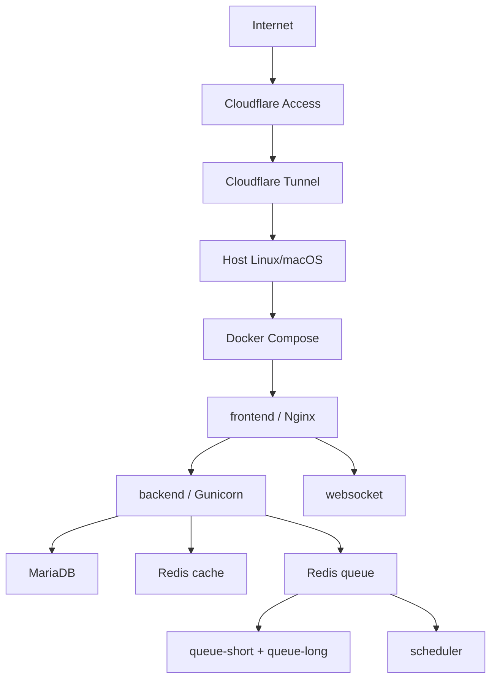

# Frappe DevOps Lab

Laboratorio reproducible para demostrar operación de Frappe/ERPNext sobre Docker Compose: servicios web, workers, scheduler, MariaDB, Redis, backups, diagnóstico y publicación segura detrás de Cloudflare Tunnel.

## Arquitectura



## Uso rápido

```bash
cp .env.example .env
# edita .env y define una contraseña local fuerte
docker compose pull
docker compose up -d
docker compose ps
./scripts/health-check.sh
```

Detener: `docker compose stop`. Eliminar contenedores sin borrar volúmenes: `docker compose down`.

Logs: `./scripts/logs.sh [servicio]`; estado: `./scripts/status.sh`.

## Backup y restore

`./scripts/backup.sh` ejecuta `bench --site all backup` dentro del contenedor backend y copia los artefactos a `backups/` (que está ignorado). Restaurar exige indicar explícitamente el archivo y confirmar: `./scripts/restore.sh backups/site-database.sql.gz`. Valida primero el entorno y no elimina volúmenes automáticamente.

## Cloudflare Tunnel

El túnel debe apuntar al frontend local, por ejemplo `http://frontend:8080` desde una red Docker dedicada o `http://127.0.0.1:8080` si `cloudflared` corre en el host. Cloudflare Access autentica antes de llegar al túnel. El token se entrega por secreto/variable de entorno fuera de Git; ver [cloudflare-tunnel.md](docs/cloudflare-tunnel.md).

## Seguridad y competencias demostradas

Secretos fuera del repositorio, mínimo privilegio, HTTPS/Access, exposición mínima de puertos, backups verificables, imágenes versionadas, health checks y procedimientos operativos. El proyecto demuestra Linux/macOS, Docker/Compose, networking, Frappe/ERPNext, MariaDB, Redis, workers, scheduler, observabilidad básica, recuperación y actualización controlada.

Consulta la documentación en `docs/` antes de usarlo en producción.

